# Mini Old Games

Rediscover the joy of classic gaming with 12 timeless mini-games, right inside your [Obsidian](https://obsidian.md) vault. Version **1.1.0**. Source: [NOMBER/Mini-Old-Games](https://github.com/NOMBER/Mini-Old-Games). English or Russian UI (English by default). Works on desktop and mobile.

## Why

Sometimes you just need a two-minute break.

- Relive a bit of **nostalgia** for the old phone and arcade games.
- Step away from heavy note-taking or studying **without leaving Obsidian**.
- Use a short game as a **pomodoro-style reset** between work sessions.
- Chase **achievements** for a little fun and motivation.
- Everything stays **offline** by default, with **no ads and no accounts** inside the game.

## Features

- A hand-drawn **gamepad icon** in the left ribbon.
- Click it for a **context menu** (default) or the **games hub** (descriptions, stats and achievements). Change this in settings.
- Play **in a popup** (default), **in a tab**, or **right in the hub**. The hub’s Play button always starts the game there; cards also have “In popup” and “In tab”. After a hub game ends you can play again, go back to the menu, press Esc, or wait 10 seconds for the menu to return.
- **Statistics** across all sessions, and **67 achievements** (per-game + global).
- **Easy / Normal / Hard** on every game, remembered per game.

The command palette also has “Play: …”, “Play in tab / popup / hub: …”, plus commands to open the hub, statistics, achievements, or close the popup. The popup itself has “Open in tab” and closes with Esc.

## Games

Every game has Easy / Normal / Hard, also changeable above the field and on hub cards.

| **Snake** | **Tetris** | **2048** | **Minesweeper** |
| :---: | :---: | :---: | :---: |
| 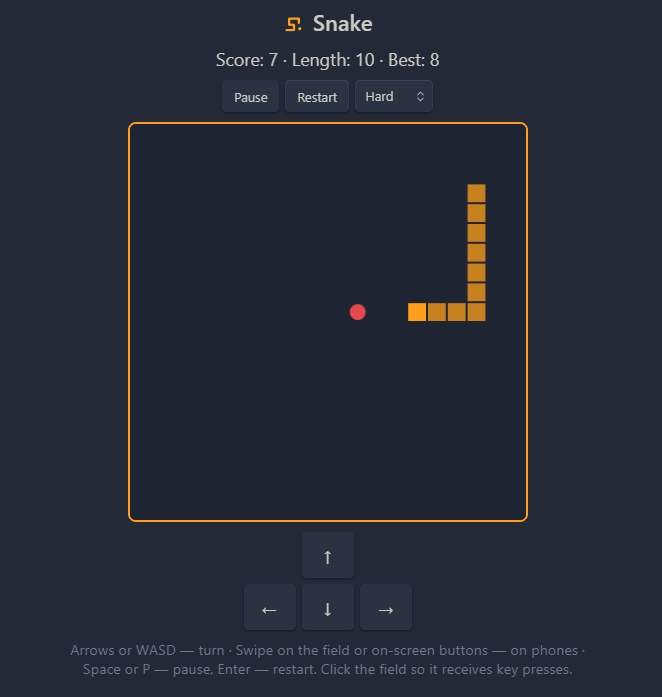 | 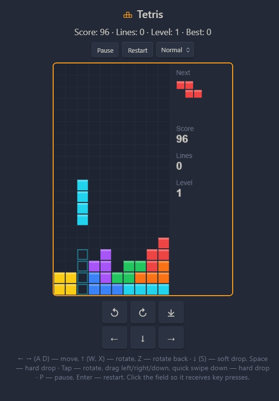 | 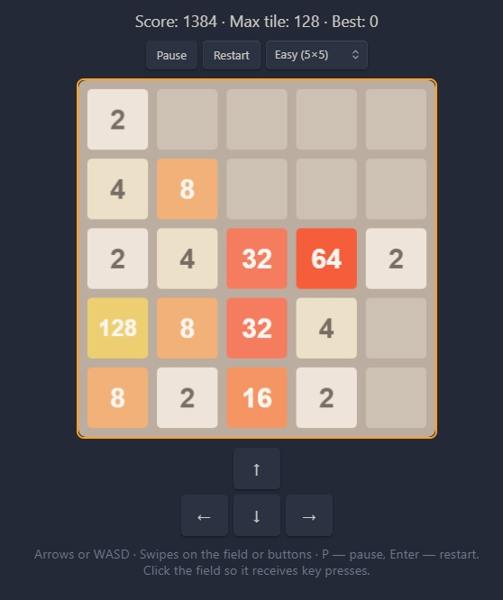 | 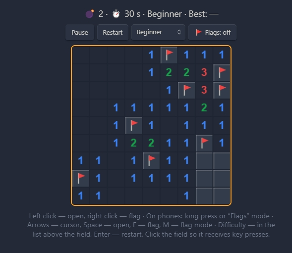 |
| **Flappy Bird** | **Breakout** | **Pong** | **Whack-a-Mole** |
| 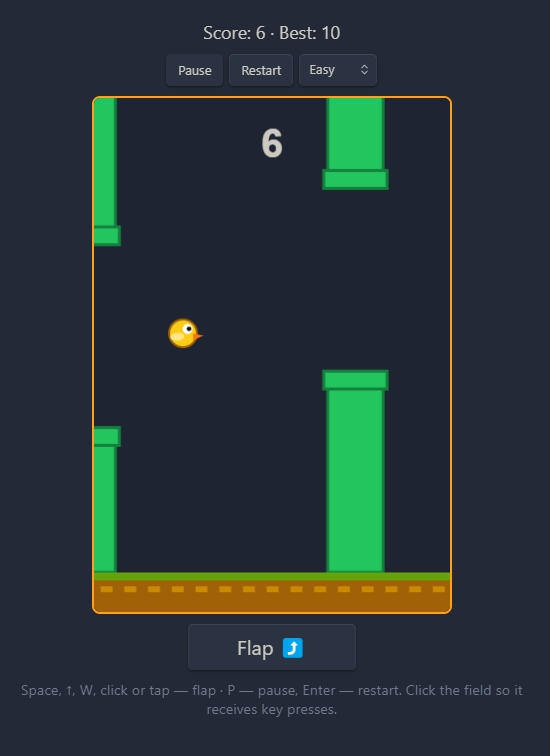 | 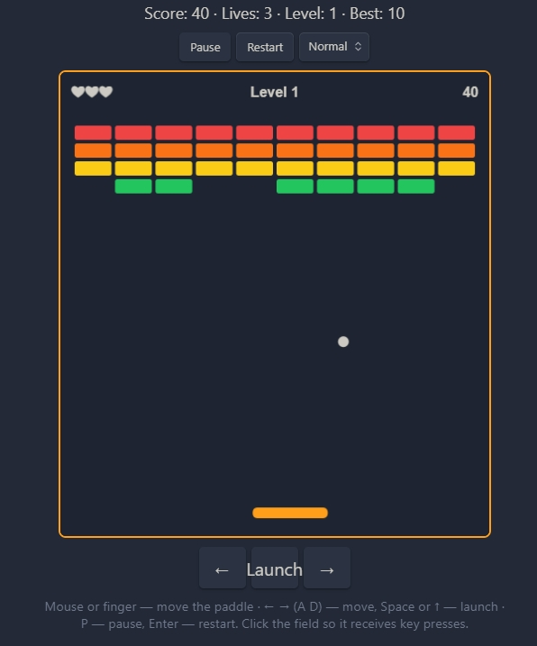 | 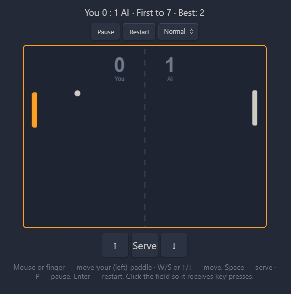 | 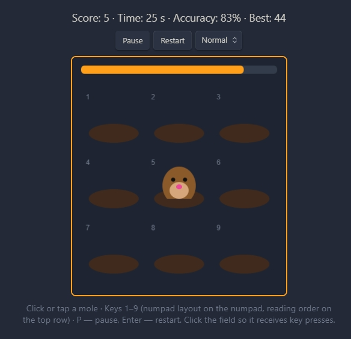 |
| **Memory** | **Space Invaders** | **Sudoku** | **Simon** |
| 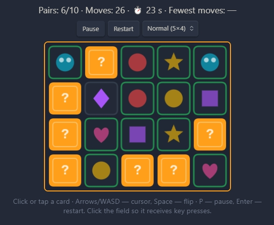 | 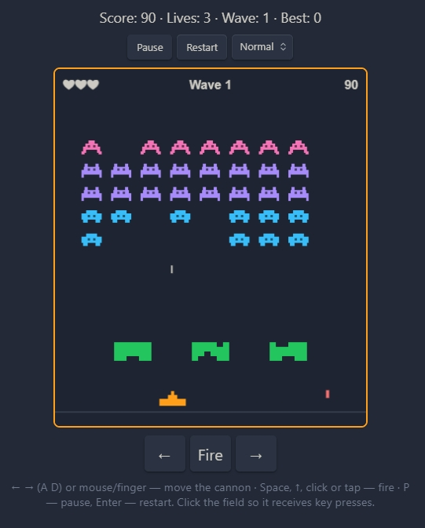 | 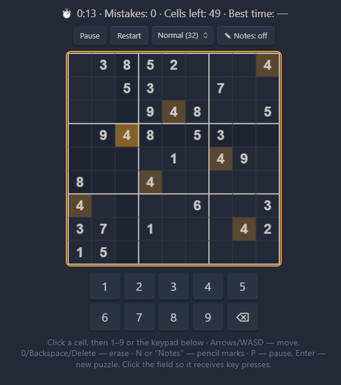 | 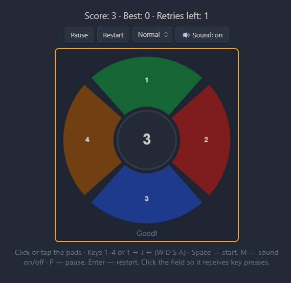 |

| Game | About | Controls | Difficulty |
| --- | --- | --- | --- |
| **Snake** | Eat apples and grow. The snake speeds up every 5 apples. Don’t hit the walls or yourself. | Arrows or WASD — turn. Swipe on the field or on-screen buttons on phones. Space or P — pause, Enter — restart. | Default **Normal**. Changes starting speed and how quickly it ramps up. |
| **Tetris** | Stack the pieces and clear full lines. Every 10 lines is a new level. Clearing 4 lines at once scores the most. | ← → (A D) — move, ↑ (W, X) — rotate, Z — rotate back, ↓ (S) — soft drop, Space — hard drop. Tap — rotate, drag left/right/down, quick swipe down — hard drop. P — pause, Enter — restart. | Default **Normal**. Easy falls slower; Hard starts at level 6. |
| **2048** | Slide tiles; equal numbers merge into one twice as big. Reach 2048 — then you can keep playing. The game ends when no moves are left. | Arrows or WASD. Swipes on the field or buttons. P — pause, Enter — restart. | **Easy** 5×5 / **Normal** 4×4 (default) / **Hard** 3×3. |
| **Minesweeper** | Open every cell that has no mine. A number shows how many mines are around it. The first click is always safe. Clicking a number whose flags are all placed opens its neighbours. | Left click — open, right click — flag. On phones: long press or “Flags” mode. Arrows — cursor, Space — open, F — flag, M — flag mode. Difficulty — in the list above the field, Enter — restart. | Default **Beginner**: Beginner (9×9, 10 mines) / Intermediate (16×16, 40 mines) / Expert (30×16, 99 mines). |
| **Flappy Bird** | Fly through the gaps between the pipes. Each pipe passed is a point. Don’t touch the pipes or the ground. The bird hovers until your first flap. | Space, ↑, W, click or tap — flap. P — pause, Enter — restart. | Default **Easy** (gentler). Normal and Hard have tighter gaps and a faster bird. |
| **Breakout** | Bounce the ball with the paddle and break the bricks. Top rows give more points. Each level adds rows and a faster ball. | Mouse or finger — move the paddle. ← → (A D) — move, Space or ↑ — launch. P — pause, Enter — restart. | Default **Normal**. Changes ball speed, paddle width, and lives (5 / 3 / 3). |
| **Pong** | Classic ping-pong against the computer. First to 7 points wins. The ball speeds up with every hit. | Mouse or finger — move your (left) paddle. W/S or ↑/↓ — move, Space — serve. P — pause, Enter — restart. | Default **Normal**. The AI gets quicker and more accurate on harder levels. |
| **Whack-a-Mole** | Moles pop out of 9 holes — hit as many as you can in 30 seconds. They get faster over time. Misses lower your accuracy. | Click or tap a mole. Keys 1–9 (numpad layout on the numpad, reading order on the top row). P — pause, Enter — restart. | Default **Normal**. Moles spawn and disappear faster on harder levels. |
| **Memory** | Find all pairs. Open two cards: matches stay open, the rest flip back. Fewer moves and less time is better. | Click or tap a card. Arrows/WASD — cursor, Space — open. P — pause, Enter — restart. | **Easy** 4×4 / **Normal** 5×4 (default) / **Hard** 6×6. |
| **Space Invaders** | Shoot the aliens before they land, hide behind the green shields and dodge the bombs. Clearing a wave brings a faster one. | ← → (A D) or mouse/finger — move the cannon. Space, ↑, click or tap — fire. P — pause, Enter — restart. | Default **Normal**. Changes alien speed, fire rate, and lives (5 / 3 / 2). |
| **Sudoku** | Fill the 9×9 grid so every row, column and 3×3 box contains 1–9 once. Each puzzle has exactly one solution. Wrong numbers and conflicts turn red and count as mistakes. Faster solves with fewer mistakes score more. | Click a cell, then 1–9 or the keypad below. Arrows/WASD — move, 0/Backspace/Delete — erase. N or “Notes” — pencil marks. P — pause, Enter — new puzzle. | Default **Normal**. About 40 / 32 / 26 given numbers on Easy / Normal / Hard. |
| **Simon** | Watch the pads light up and repeat the sequence. Every round adds one more step and the playback gets faster. Score is the longest sequence you repeat. | Click or tap the pads. Keys 1–4 or ↑ → ↓ ← (W D S A). Space — start, M — sound on/off. P — pause, Enter — restart. | Default **Normal**. Easy allows 2 retries, Normal 1, Hard is strict (no retries) and faster. |

## Achievements

**67** in total: **12** global and **55** per game. Open them from the ribbon menu, the hub tab to the right of Statistics, or Settings.

| Game | Count | Game | Count |
| --- | ---: | --- | ---: |
| Snake | 5 | Whack-a-Mole | 4 |
| Tetris | 5 | Memory | 4 |
| 2048 | 5 | Space Invaders | 5 |
| Minesweeper | 5 | Sudoku | 5 |
| Flappy Bird | 4 | Simon | 5 |
| Breakout | 4 | *Global* | 12 |
| Pong | 4 | | |

**Global**

| | Achievement | How to unlock |
| --- | --- | --- |
| 🎮 | First steps | Finish your first game session. |
| 🔟 | Regular | Play 10 sessions in total. |
| 🎯 | Enthusiast | Play 50 sessions in total. |
| 💯 | Arcade addict | Play 100 sessions in total. |
| 🌈 | Explorer | Play every one of the 12 games at least once. |
| ⏱️ | Time flies | Play for 1 hour in total. |
| 🕰️ | Marathon | Play for 5 hours in total. |
| 🏅 | All-rounder | Win in 3 different games. |
| 🔥 | No fear | Play on Hard in 3 different games. |
| 📅 | Habit | Play on 7 different days. |
| ⭐ | Collector | Unlock 10 other achievements. |
| 🌟 | Trophy hunter | Unlock 30 other achievements. |

A notice appears when you unlock one (you can turn this off). Existing stats also unlock achievements retroactively when you open the plugin.

## Settings

| Setting | Options (default in bold) |
| --- | --- |
| Language / Язык | **English**, Русский |
| Gamepad icon click | **Context menu with the games**, or the game selection tab with descriptions |
| Where to open games | **In a popup window**, in a separate tab, or in the games hub (used from the menu and the “Play: …” commands) |
| Minesweeper difficulty | **Beginner (9×9, 10 mines)**, Intermediate (16×16, 40 mines), Expert (30×16, 99 mines) |
| Difficulty per game | Easy / Normal / Hard for each other game (see the table above) |
| Simon sounds | **On** — tones via Web Audio (no sound files). Also toggled with M or the button above the field. |
| Achievement notifications | **On** — show a “🏆 …” notice when you unlock an achievement |
| Statistics | Buttons to open statistics, achievements, or all games, plus a total session count |
| Connect to OBSIGAMA | **Off** — optional sync with the OBSIGAMA game hub, with a live sync status (see below) |
| Reset statistics | Deletes best scores, history and achievements for all games. This cannot be undone (you get a confirmation). |

## Optional: OBSIGAMA sync

Mini Old Games works fully offline and never makes network requests itself.
If you also install the [OBSIGAMA](https://github.com/NOMBER/ObsiGama) plugin (a game hub for Obsidian) and turn on
**Settings → Mini Old Games → Connect to OBSIGAMA** (off by default), the game hands your results to OBSIGAMA after
each game: per-game play count, best score, wins, play time and unlocked achievements. OBSIGAMA then sends them to its
online service (Supabase) under your OBSIGAMA account, where they appear on your profile and leaderboards.
Nothing is sent while the toggle is off, OBSIGAMA is not installed, or OBSIGAMA's own online switch is off.
Turning the toggle off stops syncing; local stats are never changed.

## Installation

This plugin is installed manually (it is not in the official Community plugins list).

1. Copy the `good-old-games` folder — with `main.js`, `manifest.json`, `styles.css`, `README.md` and `LICENSE` — into `<vault>/.obsidian/plugins/`.
2. In Obsidian, open **Settings → Community plugins**, turn off Restricted mode if it is on, and enable **Mini Old Games**.

Requires Obsidian 1.0.0 or later.

## Data

Stats, achievements and settings are saved in the plugin data file (`data.json`). The optional OBSIGAMA sync keeps its own small file, `obsigama-sync.json`, and never touches `data.json`. Older data is **migrated losslessly** (`dataVersion: 2`): unknown fields are kept, missing ones get defaults, and sessions from before difficulty levels existed are assigned to the level that matched the old parameters. Minesweeper still keeps its classic Beginner / Intermediate / Expert records.

If you previously used *Mini Games* (`mini-games`) or *Mini Old Games* 1.0.3 (`mini-old-games`), those saves live under the old plugin id and are not picked up automatically.

## Changelog

- **1.1.0** — optional OBSIGAMA sync (off by default): stats, best scores and achievements can be shared with the OBSIGAMA game hub. Gameplay and saves are unchanged (bundled @obsigama/sdk 0.1.1, OBSIGAMA game manifest v2 with score caps: Pong 7, Minesweeper 381, Sudoku 3000, Memory 280).

## License

MIT © NOMBER. Bundles [@obsigama/sdk](https://github.com/NOMBER/ObsiGama) 0.1.1 (MIT, see `src/obsigama/sdk/LICENSE`).

---

  Made by NOMBER · <a href="https://nomberobsidian.github.io">More plugins &amp; projects</a> · <a href="https://donatre.github.io">Support the project ☕</a>

